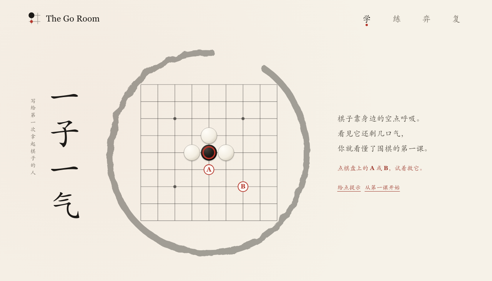
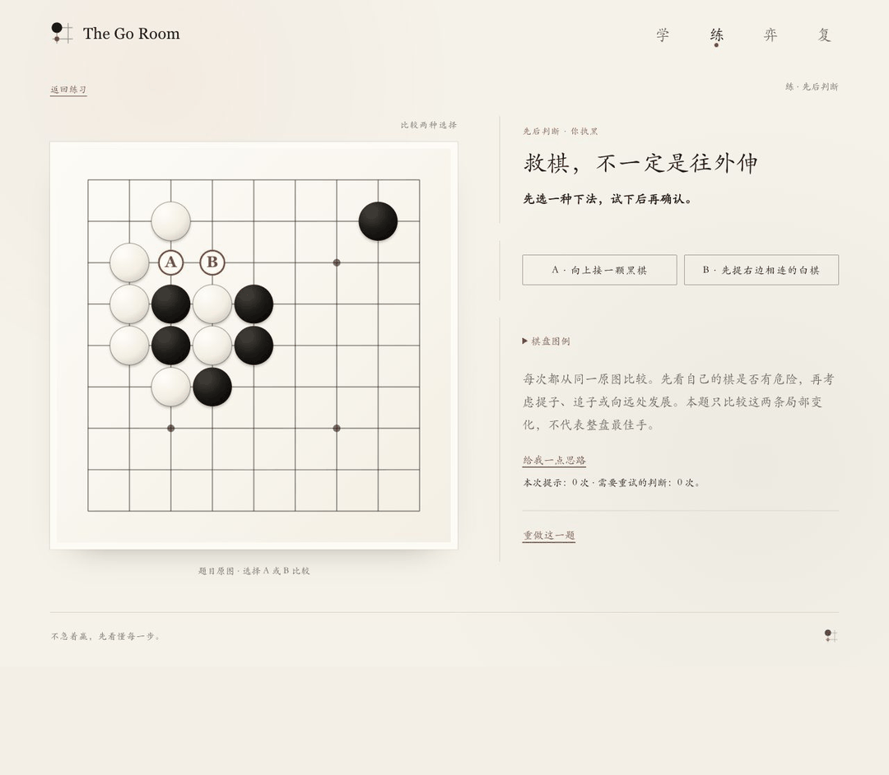

# The Go Room

[简体中文](README.md) | English

> Before trying to win, understand each move.

A browser-based introduction to Go (Weiqi / Baduk) for complete beginners. Place stones, explore what happens, and learn why a move works before playing your first full game.

**The interface and lessons are currently in Simplified Chinese.** This English README introduces the project; it does not indicate English-language support in the app.

**[Try it online (Chinese) →](https://minjia-hu.github.io/the-go-room/)**

Interactive lessons, practice problems, a simple computer opponent, and game review all run locally in your browser. No account, API key, or paid Go service is required to use the app.



## Learn · Practice · Play · Review

| Section | What you can do |
| --- | --- |
| **Learn · 学** | Learn stone placement, liberties, captures, suicide restrictions, and ko. Then explore saving groups, connecting stones, two eyes, territory, and the end of a game, followed by a guided walkthrough of a complete 9×9 game. Interactive questions explain mistakes as you go. |
| **Practice · 练** | Practice six skills: spotting danger, escaping, capturing, connecting, making two eyes, and choosing what to do first. Find problems you have not yet completed independently, or return to a related lesson. |
| **Play · 弈** | Play 9×9 Go against a simple computer opponent. Coaching is on by default: try a move, inspect its local consequences, then confirm. Retry the most recent round, mark dead stones, and score the game. |
| **Review · 复** | Keep the ten most recent completed games and replay them move by move, with explanations of rule events such as captures, ko, and the end of the game. |

The learning path has **29 lesson and practice units**. The Practice page contains **22 problems**: ten shared with the lessons, eight additional positions, and four move-priority problems. Shared problems use the same completion record. Practicing does not change your place in the learning path.

Move-priority problems ask you to compare choices such as saving a group versus capturing, or extending versus capturing to escape. Try a move, confirm it, see White's reply, then explain the result. Records distinguish independent completion, retries, and help from hints or demonstrations, keeping each problem's best result.

This roughly 40-second recording includes cursor movement, click indicators, and pauses to read each result: try extending → see Black captured → retry by capturing to save the group → explain why.



[View a still screenshot with the explanation in Chinese](docs/qa/practice-expansion/priority-wrong-desktop.png)

## Getting started

1. Start with the first lesson in **学**. Learn placement, liberties, and captures before moving on to protecting groups.
2. Visit **练** to try a different position on your own. Use hints or related lessons when you need help.
3. Play a 9×9 game in **弈** with coaching enabled. Inspect each trial move before confirming, then revisit the completed game in **复**.

Open the [live site](https://minjia-hu.github.io/the-go-room/) to get started without installing anything. To run it locally or contribute, follow the instructions below.

## Run locally

Requires **Node.js 24.x** and npm.

```bash
git clone https://github.com/Minjia-Hu/the-go-room.git
cd the-go-room
```

If you use nvm, run `nvm install` and `nvm use` in the project directory. The Node.js version is specified in [.nvmrc](.nvmrc). Then install dependencies and start the development server:

```bash
npm ci
npm run dev
```

Open the local URL printed in the terminal. Other commands:

```bash
npm test          # Run tests
npm run lint      # Check code
npm run build     # Build the static site into dist/
npm run preview   # Preview the production build locally
```

Built with Vite, React, TypeScript, and Vitest. The app is entirely frontend-based, with no backend.

The `dist/` output can be served by a static hosting service. See the [deployment notes](docs/release.md) (Chinese) for details.

## Rules and saved data

Games use a 9×9 board, Chinese area scoring, 7.5 komi for White, and positional superko: a move may not recreate an earlier board position.

Learning records, your place in the lessons, and completed games are saved in the current browser. Refreshing a lesson returns to the beginning of the saved lesson or problem; refreshing Practice returns to its list. Steps within a problem and games in progress do not survive a refresh.

Clearing browser data removes these records. Account sync and SGF import/export are not currently supported.

## Current limitations

- The computer opponent uses simple heuristics. Coaching explains local consequences; it does not provide best-move recommendations, win rates, or reliable long-term life-and-death analysis.
- You mark dead stones before scoring. The computer accepts those markings without checking them; incorrect or missing markings affect the result.
- Practice compares local outcomes. Completion records are not a certification of playing strength. Feedback on how well the lessons teach is welcome.
- Mobile layouts have been checked using browser emulation. Touch accuracy and Safari toolbar behavior still need testing on physical phones.

## Contributing and documentation

Please use [Issues](https://github.com/Minjia-Hu/the-go-room/issues) to report confusing explanations, board interaction problems, or rule errors. Include the lesson name, steps to reproduce the issue, expected behavior, browser, and screen size. Screenshots are helpful; avoid including private information.

For code contributions, work on a feature branch and run `npm test`, `npm run lint`, and `npm run build`. Check interface changes in a browser as well. See [CONTRIBUTING.md](CONTRIBUTING.md) for the full conventions.

The following documents are currently in Chinese:

- [Feature status and verification records](docs/status.md)
- [Initial design](docs/superpowers/specs/2026-11-01-v1-design.md) and [project vision](docs/vision.md)
- [Contribution guide](CONTRIBUTING.md)
- [References and third-party notices](THIRD_PARTY_NOTICES.md)

## License

The project's own code, lesson text, and assets are available under the [MIT License](LICENSE), allowing use, modification, and commercial use with the copyright and license notices retained. Third-party materials remain subject to their respective licenses; see [THIRD_PARTY_NOTICES.md](THIRD_PARTY_NOTICES.md).
