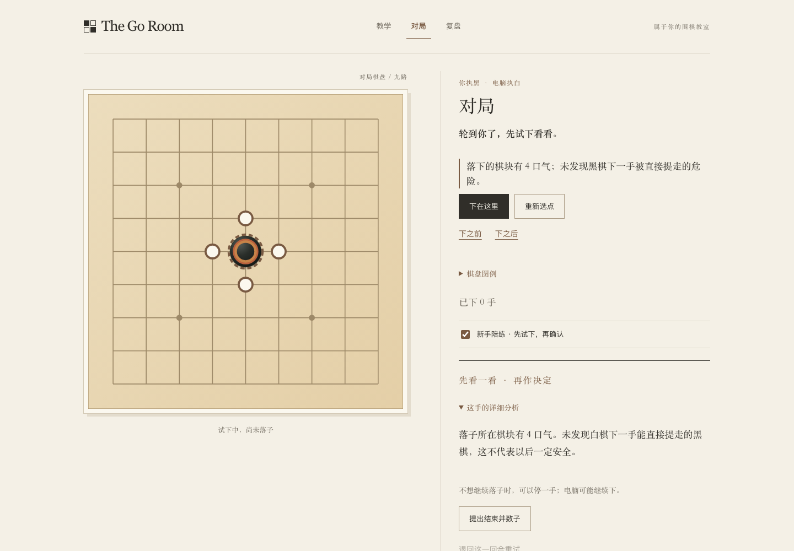

# The Go Room

一个面向零基础学习者的围棋网页：亲手落子，看懂为什么，再试着下完一盘棋。

无需账号，无需付费服务。课程、简单电脑对手和复盘都在浏览器本地运行。



## 可以做什么

- **从规则开始**：认识落子、气、提子、禁入点和劫，通过慢镜头理解提子的顺序。
- **学着保护棋子**：练习认险、救棋、连接和两眼，答错时解释原因。
- **走到一盘棋的结束**：学习围地、贴目、停手与数子，再看一盘完整九路讲解。
- **有提示地对弈**：默认先试下再确认，查看局部后果，允许退回最近一回合重试。
- **回顾自己的学习**：保存课程完成记录和最近 10 盘已完成棋谱，逐手复盘。

目前包含 29 个课程与练习单元，采用中国规则数子、白贴 7.5、全局同形禁止。

## 本地运行

需要 **Node.js 24.x** 与 npm。使用 nvm 时可先执行 `nvm install`、`nvm use`，版本系列见 [.nvmrc](.nvmrc)。

```bash
git clone https://github.com/Minjia-Hu/the-go-room.git
cd the-go-room
npm ci
npm run dev
```

打开终端显示的本地地址。其他常用命令：

```bash
npm test          # 运行测试
npm run lint      # 检查代码
npm run build     # 生成 dist/ 静态网页
npm run preview   # 本地预览构建结果
```

技术栈：Vite、React、TypeScript、Vitest。没有后端，也不需要 API 密钥。

在线演示尚未发布；静态部署与 GitHub Pages 的操作见[发布说明](docs/release.md)。

## 使用前了解

- 电脑是简单启发式对手；提示解释局部后果，不提供最佳手、胜率或可靠的长期死活判断。
- 数子前由你标记死子，电脑按约定接受，不自动核验；标错或漏标会影响结果。
- 记录只保存在当前浏览器。清除浏览器数据会丢失记录；没有账号同步或 SGF 导入导出。
- 刷新会恢复最近的课程位置，但不保留题内步骤或进行中的正式对局。课程完成记录不代表棋力认证。
- 手机布局经过浏览器模拟验证，实体手机触控与 Safari 工具栏仍需实际试用。

## 项目文档与参与

- [详细功能状态与验收记录](docs/status.md)
- [第一版设计](docs/superpowers/specs/2026-11-01-v1-design.md)与[项目愿景](docs/vision.md)
- [贡献说明](CONTRIBUTING.md)：报告问题、修改课程与提交代码
- [参考来源与第三方声明](THIRD_PARTY_NOTICES.md)

## 许可证

本项目自有代码、课程文案和资源采用 [MIT 许可证](LICENSE)，允许使用、修改和商业使用，需保留版权与许可声明。第三方内容遵循各自许可，详见[第三方声明](THIRD_PARTY_NOTICES.md)。
